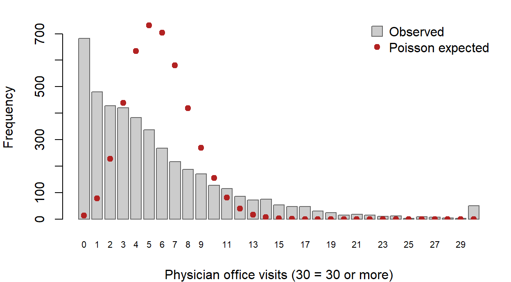

# Negative Binomial and Zero-Inflated Negative Binomial Regression by IRLS and EM

## 1 Introduction

Count outcomes, such as the number of articles a student publishes or
the number of times a person visits a doctor, are usually modelled with
Poisson regression. The Poisson model forces the variance to equal the
mean, but real count data are often **overdispersed** (the variance is
much larger than the mean) and often contain **more zeros** than a
Poisson model predicts. Ignoring either feature gives standard errors
that are too small and misleading conclusions.

The **negative binomial (NB) regression** model handles overdispersion
by adding a dispersion parameter $`\theta`$, and the **zero-inflated
negative binomial (ZINB)** model additionally allows some zeros to come
from a separate “structural zero” process. Both are available in R
through [`MASS::glm.nb()`](https://rdrr.io/pkg/MASS/man/glm.nb.html) and
[`pscl::zeroinfl()`](https://rdrr.io/pkg/pscl/man/zeroinfl.html).

The goal of this project is to implement both models **from scratch** in
an R package, **nbzinbSiam**, using only iteratively reweighted least
squares (IRLS), Newton–Raphson and the EM algorithm, without calling
[`optim()`](https://rdrr.io/r/stats/optim.html) or any other
general-purpose optimizer. We then show that the package reproduces the
reference implementations, check by simulation that it recovers known
parameters, and use it to analyse physician visits in the NMES1988 data.

## 2 Methods

### 2.1 Negative binomial regression

For counts $`y_i`$ and covariates $`x_i`$, $`i = 1, \dots, n`$, the NB2
model has

``` math
P(Y_i = y) = \frac{\Gamma(y + \theta)}{\Gamma(\theta)\, y!}
\left(\frac{\theta}{\theta + \mu_i}\right)^{\theta}
\left(\frac{\mu_i}{\theta + \mu_i}\right)^{y},
\qquad \log \mu_i = \eta_i = x_i^\top \beta + o_i,
```

where $`o_i`$ is an optional offset, so $`E(Y_i) = \mu_i`$ and
$`\mathrm{Var}(Y_i) = \mu_i + \mu_i^2/\theta`$. As $`\theta \to \infty`$
the model becomes Poisson. With prior weights $`a_i`$ the log-likelihood
is

``` math
\ell(\beta, \theta) = \sum_i a_i \bigl[\log\Gamma(y_i + \theta) - \log\Gamma(\theta)
- \log y_i! + \theta \log\theta + y_i \log \mu_i - (\theta + y_i)\log(\theta + \mu_i)\bigr].
```

**IRLS for $`\beta`$ with $`\theta`$ fixed.** With log link and variance
function $`V(\mu) = \mu + \mu^2/\theta`$, Fisher scoring is a weighted
least squares fit, repeated until $`\beta`$ stops changing, with

``` math
w_i = a_i \frac{(\partial\mu_i/\partial\eta_i)^2}{V(\mu_i)} = a_i\frac{\theta\mu_i}{\theta + \mu_i},
\qquad
z_i = (\eta_i - o_i) + \frac{y_i - \mu_i}{\mu_i},
\qquad
\beta^{(t+1)} = (X^\top W X)^{-1} X^\top W z.
```

The weighted least squares step is solved with
[`crossprod()`](https://rdrr.io/r/base/crossprod.html) and
[`solve()`](https://rdrr.io/r/base/solve.html). If a step lowers the
log-likelihood, it is halved (step-halving).

**Newton–Raphson for $`\theta`$ with $`\beta`$ fixed.** The score and
second derivative are

``` math
U(\theta) = \sum_i a_i\Bigl[\psi(y_i + \theta) - \psi(\theta) + \log\theta + 1
- \log(\theta + \mu_i) - \frac{y_i + \theta}{\theta + \mu_i}\Bigr],
```
``` math
H(\theta) = \sum_i a_i\Bigl[\psi'(y_i + \theta) - \psi'(\theta) + \frac1\theta
- \frac{2}{\theta + \mu_i} + \frac{y_i + \theta}{(\theta + \mu_i)^2}\Bigr],
```

with $`\psi`$ and $`\psi'`$ the digamma and trigamma functions. We
update $`\phi = \log\theta`$, which keeps $`\theta`$ positive, using
$`U_\phi = \theta U`$ and $`H_\phi = \theta^2 H + \theta U`$, so that
$`\phi \leftarrow \phi - U_\phi / H_\phi`$ (each step is limited to one
unit on the log scale).

**Outer loop and convergence.** We start from a Poisson fit for
$`\beta`$ and a moment estimate of $`\theta`$, then alternate the two
steps until the log-likelihood changes by less than $`10^{-8}`$. If
$`\hat\theta`$ exceeds $`10^4`$ the package warns that the data show no
overdispersion.

**Standard errors.** As in `glm.nb()`,
$`\widehat{\mathrm{Var}}(\hat\beta) =
(X^\top \hat W X)^{-1}`$, treating $`\theta`$ as known, and
$`\mathrm{SE}(\hat\theta) = \{-H(\hat\theta)\}^{-1/2}`$.

### 2.2 Zero-inflated negative binomial regression

In the ZINB model, observation $`i`$ is a structural zero with
probability $`\pi_i`$, with $`\mathrm{logit}\,\pi_i = z_i^\top\gamma`$,
and otherwise follows the NB distribution above. The observed-data
log-likelihood is

``` math
\ell(\beta, \gamma, \theta) = \sum_{i:\,y_i = 0} \log\bigl[\pi_i + (1 - \pi_i) f_{NB}(0;\mu_i,\theta)\bigr]
+ \sum_{i:\,y_i > 0} \bigl[\log(1 - \pi_i) + \log f_{NB}(y_i;\mu_i,\theta)\bigr],
```

with $`f_{NB}(0;\mu,\theta) = \{\theta/(\theta + \mu)\}^\theta`$.
Because each zero contributes the logarithm of a *sum*, this is not the
log-likelihood of a GLM, and IRLS cannot be applied to it directly.

**EM algorithm.** Introduce the latent indicator $`D_i = 1`$ if
observation $`i`$ is a structural zero. If the $`D_i`$ were known, the
problem would split into a logistic regression for $`D`$ and an NB
regression for the observations with $`D_i = 0`$. EM replaces $`D_i`$ by
its conditional expectation and alternates:

- **E-step:** $`\tau_i = P(D_i = 1 \mid y_i) =
  \pi_i / \{\pi_i + (1 - \pi_i) f_{NB}(0;\mu_i,\theta)\}`$ if
  $`y_i = 0`$, and $`\tau_i = 0`$ if $`y_i > 0`$.
- **M-step, zero part:** maximise
  $`\sum_i [\tau_i\log\pi_i + (1 - \tau_i)\log(1 - \pi_i)]`$, a logistic
  regression with fractional response $`\tau_i`$, by IRLS with
  $`w_i = \pi_i(1 - \pi_i)`$ and working response
  $`z_i^\top\gamma + (\tau_i - \pi_i)/\{\pi_i(1 - \pi_i)\}`$.
- **M-step, count part:** maximise
  $`\sum_i (1 - \tau_i)\log f_{NB}(y_i;\mu_i,\theta)`$, which is exactly
  the NB fit above with prior weights $`a_i = 1 - \tau_i`$.

We start from the NB fit for $`(\beta, \theta)`$ and a logistic
regression of $`I(y_i = 0)`$ on $`z_i`$ for $`\gamma`$, and stop when
the observed-data log-likelihood changes by less than $`10^{-8}`$. EM
never decreases $`\ell`$; the package records $`\ell`$ at every
iteration and the tests check this.

**Standard errors.** EM does not produce standard errors, so we invert
the observed information matrix,
$`\widehat{\mathrm{Var}} = \{-\nabla^2 \ell\}^{-1}`$, with respect to
$`(\beta, \gamma, \log\theta)`$ at the MLE. We derived the Hessian
**analytically**. Writing each contribution as
$`\ell_i = \log(e^{A_i} + e^{B_i})`$ with $`A_i = \log\pi_i`$ and
$`B_i = \log(1 - \pi_i) + \log f_{NB}(y_i;\mu_i,\theta)`$, so that
$`\tau_i`$ is the weight of the first component,

``` math
\nabla^2\ell_i = \tau_i\nabla^2 A_i + (1 - \tau_i)\nabla^2 B_i
+ \tau_i(1 - \tau_i)(\nabla A_i - \nabla B_i)(\nabla A_i - \nabla B_i)^\top,
```

where the derivatives of $`B_i`$ use the NB derivatives with respect to
$`\eta_i`$ and $`\log\theta`$. This gives six blocks of the Hessian,
each a weighted cross-product such as
$`\sum_i[(1 - \tau_i)\ell_{\eta\eta,i} + \tau_i(1 - \tau_i)\ell_{\eta,i}^2]\,x_i x_i^\top`$
for $`(\beta, \beta)`$ and
$`\sum_i[\tau_i(1 - \tau_i) - \pi_i(1 - \pi_i)]\,z_i z_i^\top`$ for
$`(\gamma, \gamma)`$; the full derivation is in the comments of
`R/zinb_hessian.R`. The analytic Hessian agrees with
[`numDeriv::hessian()`](https://rdrr.io/pkg/numDeriv/man/hessian.html)
applied to our log-likelihood (also available through
`zinbreg_control(hessian = "numerical")`) to about $`10^{-7}`$ and is
about 30 times faster.

## 3 The R package

The package is installed with

``` r

# install.packages("devtools")
devtools::install_github("AshfakSiam/nbzinbSiam")
```

**Design.** Each algorithmic step is a small internal function that is
tested on its own, and the user-facing functions are thin layers on top:

| File | Contents |
|----|----|
| `R/utils.R` | `nb_loglik()` and `wls_solve()`, the weighted least squares step |
| `R/nb_irls.R` | `nb_irls()`: IRLS for $`\beta`$ with $`\theta`$ fixed |
| `R/nb_theta.R` | $`U(\theta)`$, $`H(\theta)`$ and `nb_theta_newton()` |
| `R/nbreg.R` | `nb_fit()` (the outer loop) and the exported [`nbreg()`](https://ashfaksiam.github.io/nbzinbSiam/reference/nbreg.md), [`nbreg_control()`](https://ashfaksiam.github.io/nbzinbSiam/reference/nbreg_control.md) |
| `R/zinb_utils.R` | ZINB log-likelihood, E-step, fractional logistic IRLS |
| `R/zinbreg.R` | `zinb_fit()` (the EM loop) and the exported [`zinbreg()`](https://ashfaksiam.github.io/nbzinbSiam/reference/zinbreg.md), [`zinbreg_control()`](https://ashfaksiam.github.io/nbzinbSiam/reference/zinbreg_control.md) |
| `R/zinb_hessian.R`, `R/zinb_se.R` | analytic gradient and Hessian, variance-covariance matrix |
| `R/methods_*.R` | S3 methods for both classes |

Because `nb_fit()` accepts prior weights, the ZINB count-part M-step
reuses the NB code unchanged.
[`zinbreg()`](https://ashfaksiam.github.io/nbzinbSiam/reference/zinbreg.md)
reads the two-part formula `y ~ x1 + x2 | z1 + z2` with the **Formula**
package; without `|`, the same covariates are used in both parts. Both
fitting functions accept an offset, in the formula or as an argument.

**S3 methods.**
[`nbreg()`](https://ashfaksiam.github.io/nbzinbSiam/reference/nbreg.md)
and
[`zinbreg()`](https://ashfaksiam.github.io/nbzinbSiam/reference/zinbreg.md)
return objects of class `"nbreg"` and `"zinbreg"` with methods `print`,
`summary` (coefficient tables with estimates, standard errors, $`z`$
values and $`p`$-values), `coef`, `vcov`, `logLik` (with a `df`
attribute, so [`AIC()`](https://rdrr.io/r/stats/AIC.html) and
[`BIC()`](https://rdrr.io/r/stats/AIC.html) work), `fitted`, `residuals`
(response and Pearson), `nobs` and `predict` (with `newdata`; for ZINB,
`type = "response"`, `"count"` or `"zero"`).

**Quality checks.** Every exported function has roxygen2 documentation
with runnable examples. The **testthat** suite compares each building
block and each model with [`glm()`](https://rdrr.io/r/stats/glm.html),
[`MASS::glm.nb()`](https://rdrr.io/pkg/MASS/man/glm.nb.html),
[`pscl::zeroinfl()`](https://rdrr.io/pkg/pscl/man/zeroinfl.html) and
numerical derivatives, checks offsets, single-covariate models and input
errors, and scans the package code for prohibited functions such as
[`optim()`](https://rdrr.io/r/stats/optim.html) and
[`glm()`](https://rdrr.io/r/stats/glm.html). `R CMD check` runs on every
push through GitHub Actions.

**Example.**

``` r

data("bioChemists", package = "pscl")
fit <- zinbreg(art ~ fem + mar + kid5 + phd + ment | ment,
               data = bioChemists)
coef(fit, model = "zero")
```

    (Intercept)        ment
     -0.8066566  -0.6094417 

``` r

AIC(fit)
```

    [1] 3124.542

## 4 Benchmarking

We compared
[`nbreg()`](https://ashfaksiam.github.io/nbzinbSiam/reference/nbreg.md)
with [`MASS::glm.nb()`](https://rdrr.io/pkg/MASS/man/glm.nb.html) and
[`zinbreg()`](https://ashfaksiam.github.io/nbzinbSiam/reference/zinbreg.md)
with [`pscl::zeroinfl()`](https://rdrr.io/pkg/pscl/man/zeroinfl.html) on
`bioChemists` (all five covariates in both parts of the ZINB model) and
on NMES1988 (the models of [Section 6](#sec-nmes)). The reference
functions were run with tight tolerances (`epsilon = 1e-10` and
`reltol = 1e-12`). [Table 1](#tbl-agree) reports the maximum absolute
differences; the full side-by-side estimates are in the Appendix.

| Comparison       | Coefficients |   SEs   |  theta  | logLik  | Within tolerance |
|:-----------------|:------------:|:-------:|:-------:|:-------:|:----------------:|
| bioChemists NB   |   1.3e-09    | 1.5e-11 | 4.2e-10 | 4.5e-13 |       yes        |
| bioChemists ZINB |   1.5e-04    | 9.4e-05 | 1.3e-05 | 4.2e-08 |       yes        |
| NMES1988 NB      |   2.0e-09    | 5.3e-12 | 8.1e-11 | 3.6e-12 |       yes        |
| NMES1988 ZINB    |   2.6e-05    | 1.7e-05 | 4.4e-06 | 1.6e-08 |       yes        |

Table 1: Maximum absolute differences from the reference implementations
(for ZINB, the theta column compares log(theta)). All are below the
required tolerances: 1e-5 (coefficients, SEs) and 1e-4 (theta,
log-likelihood) for NB, and 1e-3 for ZINB.

All differences are well inside the required tolerances. The NB results
agree to about $`10^{-9}`$, because both programs solve the same score
equations with similar algorithms. The ZINB differences are larger (up
to about $`10^{-4}`$) and come mostly from the zero-part coefficients,
whose likelihood surface is flat (their standard errors are large), so
the two algorithms stop at slightly different points of essentially the
same maximum: the log-likelihoods agree to about $`10^{-8}`$.

| Comparison       | Ours  | Reference | Iterations |
|:-----------------|:-----:|:---------:|:----------:|
| bioChemists NB   | 0.030 |   0.110   |     4      |
| bioChemists ZINB | 2.020 |   0.390   |    111     |
| NMES1988 NB      | 0.160 |   0.360   |     3      |
| NMES1988 ZINB    | 4.190 |   1.800   |     53     |

Table 2: Computation time in seconds (median of three runs) and number
of outer (NB) or EM (ZINB) iterations of our functions.

[Table 2](#tbl-time) shows that
[`nbreg()`](https://ashfaksiam.github.io/nbzinbSiam/reference/nbreg.md)
is faster than `glm.nb()`, which calls the full
[`glm()`](https://rdrr.io/r/stats/glm.html) machinery inside each
iteration.
[`zinbreg()`](https://ashfaksiam.github.io/nbzinbSiam/reference/zinbreg.md)
is slower than `zeroinfl()`: EM needs 111 iterations on `bioChemists`,
each a complete NB fit and logistic fit, whereas `zeroinfl()` uses a
quasi-Newton optimizer with an analytic gradient. All fits take at most
a few seconds.

## 5 Simulation study

To check that
[`zinbreg()`](https://ashfaksiam.github.io/nbzinbSiam/reference/zinbreg.md)
recovers known parameters we simulated $`R = 100`$ data sets of size
$`n = 500`$ from a ZINB model with $`x_i, z_i \sim N(0, 1)`$,
$`\log\mu_i = 1 + 0.5\,x_i`$, $`\mathrm{logit}\,\pi_i = -1 + 0.8\,z_i`$
and $`\theta = 2`$; on average 43% of the responses are zero. The study
is run by `inst/benchmark/simulation.R` with seed 2026; its results are
stored in the package and loaded here, and rerunning the script
reproduces them exactly.

| Parameter          |  True  |  Mean  |  Bias  | MC SD | Mean SE | Coverage |
|:-------------------|:------:|:------:|:------:|:-----:|:-------:|:--------:|
| count\_(Intercept) | 1.000  | 0.990  | -0.010 | 0.065 |  0.066  |   0.97   |
| count_x            | 0.500  | 0.491  | -0.009 | 0.057 |  0.054  |   0.94   |
| zero\_(Intercept)  | -1.000 | -1.057 | -0.057 | 0.241 |  0.230  |   0.93   |
| zero_z             | 0.800  | 0.831  | 0.031  | 0.172 |  0.186  |   1.00   |
| Log(theta)         | 0.693  | 0.710  | 0.017  | 0.225 |  0.215  |   0.91   |

Table 3: Simulation results over 100 data sets: mean estimate, bias,
Monte Carlo standard deviation of the estimates, mean estimated standard
error, and empirical coverage of 95% Wald intervals.

All 100 fits converged, in 45 EM iterations on average.
[Table 3](#tbl-sim) shows that the biases are small compared with the
Monte Carlo standard deviations, so the estimates are essentially
unbiased at $`n = 500`$. The mean estimated standard errors are within
about 10% of the Monte Carlo standard deviations for every parameter,
which confirms that the analytic Hessian measures the sampling
variability correctly. The coverage of the 95% intervals ranges from
0.91 to 1.00. With only 100 replications, a coverage estimate has a
Monte Carlo standard error of about 0.022, so these values are
consistent with the nominal 95%; the zero-part parameters, which are the
hardest to estimate, show the largest deviations.

## 6 Data analysis: NMES1988

The `NMES1988` data (Deb and Trivedi 1997), included in the **AER**
package, record the number of physician office visits (`visits`) in
1987–88 for 4,406 people aged 66 and over in the US National Medical
Expenditure Survey. We model `visits` with the covariates

- `hospital`: number of hospital stays;
- `health`: self-perceived health, with levels `poor`, `average` (the
  reference level) and `excellent`;
- `chronic`: number of chronic conditions;
- `gender`: `female` (reference) or `male`;
- `school`: number of years of education;
- `insurance`: whether the person has private insurance (`no` is the
  reference).

### 6.1 Overdispersion and excess zeros

The mean number of visits is 5.77, but the variance is 45.69, about 8
times the mean. A Poisson distribution would have variance equal to its
mean, so the data are strongly **overdispersed**. In addition, 683
people (15.5%) made no visit at all, while a Poisson distribution with
the same mean predicts only 0.3% zeros (about 14 people).
[Figure 1](#fig-nmes-dist) shows both features: far too many zeros and a
much longer right tail than the Poisson distribution allows. Both
motivate the NB and ZINB models.



Figure 1: Observed frequencies of physician office visits (bars) and the
frequencies expected under a Poisson distribution with the same mean
(points). The last bar collects 30 or more visits.

### 6.2 Models

We fit three models with the count-model covariates listed above: a
Poisson regression (with [`glm()`](https://rdrr.io/r/stats/glm.html),
for reference), an NB regression with
[`nbreg()`](https://ashfaksiam.github.io/nbzinbSiam/reference/nbreg.md),
and a ZINB regression with
[`zinbreg()`](https://ashfaksiam.github.io/nbzinbSiam/reference/zinbreg.md).
Following the project description, the zero-inflation part of the ZINB
model uses `hospital`, `chronic`, `gender`, `school` and `insurance`. We
also tried adding `health` to the zero part: this raises the
log-likelihood by only 0.08 for two extra parameters, neither health
coefficient is significant, and both AIC (24215.3 vs 24211.4) and BIC
(24323.9 vs 24307.3) prefer the smaller zero model, so we keep it.

### 6.3 Model comparison

| Model   |  df |   logLik |     AIC |     BIC | Expected zeros |
|:--------|----:|---------:|--------:|--------:|---------------:|
| Poisson |   8 | -17971.6 | 35959.2 | 36010.4 |           46.7 |
| NB      |   9 | -12170.6 | 24359.1 | 24416.6 |          608.0 |
| ZINB    |  15 | -12090.7 | 24211.4 | 24307.3 |          708.9 |

Table 4: Model comparison for NMES1988 (observed zeros = 683).

[Table 4](#tbl-nmes-compare) compares the three models. The Poisson
model fits very poorly: it predicts only 47 zeros against 683 observed,
and its AIC is 11,600 higher than the NB model’s. Allowing for
overdispersion ($`\hat\theta =`$ 1.21) fixes most of the problem, but
the NB model still **under-predicts** the zeros (608 expected vs 683
observed). The ZINB model predicts 709 zeros, closer to the observed
count, and improves the log-likelihood by 79.8 at the cost of 6 extra
parameters. Unlike in the `bioChemists` example, **both AIC and BIC
favour the ZINB model** here (AIC 24211.4 vs 24359.1; BIC 24307.3 vs
24416.6).

### 6.4 Interpretation

| Covariate       |  NB IRR (95% CI)  | ZINB count IRR (95% CI) |
|:----------------|:-----------------:|:-----------------------:|
| hospital        | 1.24 (1.20, 1.29) |    1.22 (1.18, 1.27)    |
| healthpoor      | 1.36 (1.23, 1.49) |    1.33 (1.22, 1.45)    |
| healthexcellent | 0.71 (0.63, 0.80) |    0.73 (0.65, 0.82)    |
| chronic         | 1.19 (1.16, 1.22) |    1.14 (1.11, 1.16)    |
| gendermale      | 0.88 (0.83, 0.94) |    0.92 (0.87, 0.98)    |
| school          | 1.03 (1.02, 1.04) |    1.02 (1.01, 1.03)    |
| insuranceyes    | 1.25 (1.16, 1.35) |    1.13 (1.05, 1.23)    |

Table 5: Count part: incidence rate ratios (IRR) with 95% Wald
confidence intervals.

| Covariate    |    OR (95% CI)    | p-value |
|:-------------|:-----------------:|:-------:|
| hospital     | 0.45 (0.20, 1.02) | 0.0571  |
| chronic      | 0.29 (0.20, 0.41) | \<1e-04 |
| gendermale   | 1.91 (1.29, 2.83) | 0.0012  |
| school       | 0.92 (0.87, 0.97) | 0.0014  |
| insuranceyes | 0.31 (0.20, 0.48) | \<1e-04 |

Table 6: ZINB zero part: odds ratios (OR) of being a structural zero (a
person who would not visit a physician under any circumstances), with
95% Wald confidence intervals.

**Dispersion.** The NB model estimates $`\hat\theta =`$ 1.21 (SE 0.034).
For a person whose expected number of visits equals the sample mean of
5.77, the NB variance $`\mu + \mu^2/\theta`$ is about 33.4, almost six
times the Poisson variance. (The observed variance of 45.7 is larger
still, because it also includes the variation in expected visits between
people.)

**Count part ([Table 5](#tbl-nmes-irr)).** Holding the other variables
fixed, and using the ZINB count model, which describes people who do
visit physicians:

- Each additional **chronic condition** multiplies the expected number
  of visits by 1.14 (about 14% more), and each **hospital stay** by
  1.22.
- People in **poor health** make about 33% more visits than those in
  average health, and people in **excellent health** about 27% fewer.
- **Private insurance** raises the expected number of visits by about
  13%, each **year of schooling** by about 2.2%, and **men** make about
  8% fewer visits than women.

All of these effects are significant at the 1% level in both models,
with the same signs. The ZINB count effects are somewhat smaller than
the NB effects (for example, insurance: IRR 1.25 in the NB model vs 1.13
in the ZINB count model), because in the ZINB model part of each
covariate’s effect works through the zero part instead.

**Zero part ([Table 6](#tbl-nmes-or)).** These odds ratios describe who
belongs to the group that does not visit a physician at all:

- Each additional **chronic condition** multiplies the odds of being a
  structural zero by 0.29, a 71% reduction: people with chronic
  conditions almost always see a doctor.
- **Private insurance** multiplies these odds by 0.31 (69% lower), and
  each **year of schooling** by 0.92.
- **Men** have 1.91 times the odds of women of being structural
  non-users.
- The effect of **hospital stays** is large in size (OR 0.45) but only
  marginally significant (p = 0.057). The estimate is imprecise because
  few people with a hospital stay made no physician visit (only 65 of
  865), so the data carry little information about structural zeros in
  this group.

Several covariates therefore act in **both parts in the same
direction**: chronic conditions, insurance and education make a person
less likely to avoid physicians entirely *and* lead to more visits among
those who do see one, while men are both more likely to be non-users and
make fewer visits.

### 6.5 Which model do we prefer?

We prefer the **ZINB model** for these data. It has clearly the best AIC
and BIC, it reproduces the number of zeros much better than the NB
model, and its two parts have a sensible interpretation: a “never-user”
process driven mainly by chronic illness, insurance, education and
gender, and a count process for how often users see a physician. The NB
model remains a reasonable, simpler summary of the count effects, since
its incidence rate ratios have the same signs and similar sizes.

## 7 Discussion

We implemented NB and ZINB regression using only IRLS, Newton–Raphson
and EM, and showed that the results agree with `glm.nb()` and
`zeroinfl()` well within the required tolerances, that the ZINB
estimator and its analytic standard errors behave as expected in
simulation, and that the ZINB model describes the NMES1988 physician
visits better than the NB model.

**Limitations.**

- **EM converges slowly near the optimum.** Each EM step increases the
  log-likelihood only a little once it is close to the maximum, so the
  stopping rule “change in log-likelihood below $`10^{-8}`$” can stop
  while the parameters are still moving slightly. On `bioChemists` the
  gradient of the log-likelihood at our solution is about $`10^{-3}`$;
  tightening the tolerance to $`10^{-12}`$ reduces it to about
  $`10^{-5}`$ at the cost of about 50 more iterations. The resulting
  differences are far below the standard errors, but they explain why
  the ZINB agreement is around $`10^{-4}`$ rather than $`10^{-9}`$.
- **Speed.** For the same reason
  [`zinbreg()`](https://ashfaksiam.github.io/nbzinbSiam/reference/zinbreg.md)
  is several times slower than `zeroinfl()`, although still fast enough
  for data sets of this size.
- **NB standard errors treat $`\theta`$ as known**, as `glm.nb()` does.
  This ignores the small correlation between $`\hat\beta`$ and
  $`\hat\theta`$.
- **Features.** The zero part cannot have its own offset, and users
  cannot supply observation weights; the internal functions already
  support weights.

**Possible extensions.** EM could be accelerated (for example with
SQUAREM), or a few Newton steps on the full log-likelihood could be
taken after EM using the analytic gradient and Hessian we already have.
The same building blocks would also give hurdle models and zero-inflated
Poisson regression with little extra code.

## 8 AI-use statement

I used Claude (Anthropic’s AI assistant) as a programming assistant
throughout the project, as the course encourages. I worked in small
steps: for each step, Claude explained what we were about to implement
and which equations of the project description it corresponded to, wrote
the code and the tests, and told me what output to expect. I then ran
everything myself in R on my own computer, compared the output with the
expected values and with the reference functions, and only then
committed the step to GitHub. The commit history records these steps.

**What I asked it to do.** Set up the package structure; implement each
algorithm exactly as written in Sections 2–3 of the project description
(the IRLS weights and working response, the Newton–Raphson update for
$`\log\theta`$, the E-step $`\tau_i`$ and both M-steps); derive and code
the analytic Hessian; write the S3 methods, tests, benchmark and
simulation scripts; and draft this report. The rule that
[`optim()`](https://rdrr.io/r/stats/optim.html),
[`glm()`](https://rdrr.io/r/stats/glm.html) and the other prohibited
functions must not be used in `R/` is recorded in the project’s
`CLAUDE.md` file, and a test scans the package code for them.

**What I verified myself.** I checked that the code implements the
equations of the project description (for example the weights
$`\theta\mu_i/(\theta + \mu_i)`$ in `nb_irls()` and the E-step formula
in `zinb_estep()`), ran every test and `R CMD check` locally, compared
the
[`nbreg()`](https://ashfaksiam.github.io/nbzinbSiam/reference/nbreg.md)
and
[`zinbreg()`](https://ashfaksiam.github.io/nbzinbSiam/reference/zinbreg.md)
output line by line with `glm.nb()` and `zeroinfl()`, confirmed that the
EM log-likelihood never decreased, and checked that the simulation
results reproduced exactly on my computer.

**Where its output was wrong.** Early in the project Claude told me
twice that I did not need Rtools on Windows because the package contains
no compiled code. When I ran
[`devtools::check()`](https://devtools.r-lib.org/reference/check.html)
it failed with “Could not find tools necessary to compile a package”, so
the advice was wrong: the check needs the build tools even for a pure-R
package. I installed Rtools45 and the check then passed. Several of
Claude’s own first-draft tests also failed when run and had to be
corrected before I used them, for example a test that compared
[`zinbreg()`](https://ashfaksiam.github.io/nbzinbSiam/reference/zinbreg.md)
residuals with [`residuals()`](https://rdrr.io/r/stats/residuals.html)
of a `zeroinfl` fit, which returns Pearson rather than response
residuals by default.

A second case was caught by continuous integration rather than on my own
computer. After I pushed the analytic Hessian, all 127 tests passed
locally, but the GitHub Actions run failed on the macOS (ARM) machine
while passing on Windows and Linux. I opened the job log, found the
failing test (“analytic and numerical standard errors agree”) and saw
that the two variance matrices differed by up to about
$`1.3 \times 10^{-6}`$ (relative), just above the tolerance of
$`10^{-6}`$ that Claude had chosen. The analytic Hessian is exact; it is
the finite-difference approximation from `numDeriv` that is slightly
less accurate on that processor. The tolerance was therefore too strict
rather than the code wrong, so I loosened it to $`10^{-5}`$, which is
still 100 times stricter than the $`10^{-3}`$ required for the ZINB
standard errors, and the CI run passed on all platforms. These cases
showed me that every suggestion has to be checked by running it, and on
more than one machine.

## References

- Cameron, A. C. and Trivedi, P. K. (2013). *Regression Analysis of
  Count Data* (2nd ed.). Cambridge University Press.
- Deb, P. and Trivedi, P. K. (1997). Demand for medical care by the
  elderly: A finite mixture approach. *Journal of Applied Econometrics*,
  12(3), 313–336.
- Dempster, A. P., Laird, N. M. and Rubin, D. B. (1977). Maximum
  likelihood from incomplete data via the EM algorithm. *Journal of the
  Royal Statistical Society, Series B*, 39(1), 1–38.
- Lambert, D. (1992). Zero-inflated Poisson regression, with an
  application to defects in manufacturing. *Technometrics*, 34(1), 1–14.
- Long, J. S. (1997). *Regression Models for Categorical and Limited
  Dependent Variables*. Sage.
- McCullagh, P. and Nelder, J. A. (1989). *Generalized Linear Models*
  (2nd ed.). Chapman & Hall.
- Venables, W. N. and Ripley, B. D. (2002). *Modern Applied Statistics
  with S* (4th ed.). Springer.
- Wickham, H. and Bryan, J. (2023). *R Packages* (2nd ed.). O’Reilly.
  <https://r-pkgs.org>
- Zeileis, A., Kleiber, C. and Jackman, S. (2008). Regression models for
  count data in R. *Journal of Statistical Software*, 27(8), 1–25.

## Appendix: side-by-side estimates

| Parameter   |   Ours    | Reference | SE ours  | SE reference | Abs. difference |
|:------------|:---------:|:---------:|:--------:|:------------:|:---------------:|
| (Intercept) | 0.256144  | 0.256144  | 0.137348 |   0.137348   |     1.3e-09     |
| femWomen    | -0.216418 | -0.216418 | 0.072636 |   0.072636   |     2.6e-10     |
| marMarried  | 0.150489  | 0.150489  | 0.082097 |   0.082097   |     1.1e-10     |
| kid5        | -0.176415 | -0.176415 | 0.052813 |   0.052813   |     2.2e-10     |
| phd         | 0.015271  | 0.015271  | 0.035873 |   0.035873   |     9.0e-11     |
| ment        | 0.029082  | 0.029082  | 0.003214 |   0.003214   |     9.4e-11     |
| theta       | 2.264388  | 2.264388  | 0.271176 |   0.271175   |     4.2e-10     |

bioChemists NB: our estimates vs. glm.nb() (maximum absolute difference
in the estimates: 1.3e-09). {.table .caption-top}

| Parameter          |   Ours    | Reference | SE ours  | SE reference | Abs. difference |
|:-------------------|:---------:|:---------:|:--------:|:------------:|:---------------:|
| count\_(Intercept) | 0.416749  | 0.416747  | 0.143596 |   0.143597   |     2.3e-06     |
| count_femWomen     | -0.195505 | -0.195507 | 0.075592 |   0.075593   |     2.3e-06     |
| count_marMarried   | 0.097584  | 0.097583  | 0.084452 |   0.084452   |     1.3e-06     |
| count_kid5         | -0.151731 | -0.151732 | 0.054206 |   0.054206   |     1.7e-06     |
| count_phd          | -0.000699 | -0.000700 | 0.036270 |   0.036270   |     6.4e-07     |
| count_ment         | 0.024786  | 0.024786  | 0.003492 |   0.003493   |     3.1e-07     |
| zero\_(Intercept)  | -0.191839 | -0.191688 | 1.322724 |   1.322819   |     1.5e-04     |
| zero_femWomen      | 0.635945  | 0.635933  | 0.848851 |   0.848918   |     1.2e-05     |
| zero_marMarried    | -1.499317 | -1.499468 | 0.938588 |   0.938671   |     1.5e-04     |
| zero_kid5          | 0.628406  | 0.628427  | 0.442758 |   0.442783   |     2.1e-05     |
| zero_phd           | -0.037682 | -0.037715 | 0.307987 |   0.308008   |     3.3e-05     |
| zero_ment          | -0.882218 | -0.882293 | 0.316192 |   0.316228   |     7.6e-05     |
| Log(theta)         | 0.976369  | 0.976357  | 0.135469 |   0.135469   |     1.3e-05     |

bioChemists ZINB: our estimates vs. zeroinfl() (maximum absolute
difference in the estimates: 1.5e-04). {.table .caption-top}

| Parameter       |   Ours    | Reference | SE ours  | SE reference | Abs. difference |
|:----------------|:---------:|:---------:|:--------:|:------------:|:---------------:|
| (Intercept)     | 0.929257  | 0.929257  | 0.054591 |   0.054591   |     2.0e-09     |
| hospital        | 0.217772  | 0.217772  | 0.020176 |   0.020176   |     1.5e-09     |
| healthpoor      | 0.305013  | 0.305013  | 0.048511 |   0.048511   |     1.3e-09     |
| healthexcellent | -0.341807 | -0.341807 | 0.060924 |   0.060924   |     3.3e-10     |
| chronic         | 0.174916  | 0.174916  | 0.012092 |   0.012092   |     5.6e-10     |
| gendermale      | -0.126488 | -0.126488 | 0.031216 |   0.031216   |     2.3e-10     |
| school          | 0.026815  | 0.026815  | 0.004394 |   0.004394   |     2.7e-11     |
| insuranceyes    | 0.224402  | 0.224402  | 0.039464 |   0.039464   |     2.6e-10     |
| theta           | 1.206604  | 1.206604  | 0.033555 |   0.033555   |     8.1e-11     |

NMES1988 NB: our estimates vs. glm.nb() (maximum absolute difference in
the estimates: 2.0e-09). {.table .caption-top}

| Parameter | Ours | Reference | SE ours | SE reference | Abs. difference |
|:---|:--:|:--:|:--:|:--:|:--:|
| count\_(Intercept) | 1.193716 | 1.193713 | 0.056661 | 0.056661 | 3.2e-06 |
| count_hospital | 0.201477 | 0.201477 | 0.020360 | 0.020360 | 3.0e-08 |
| count_healthpoor | 0.285133 | 0.285133 | 0.045093 | 0.045093 | 6.2e-08 |
| count_healthexcellent | -0.319336 | -0.319336 | 0.060405 | 0.060405 | 6.4e-09 |
| count_chronic | 0.128999 | 0.129000 | 0.011931 | 0.011931 | 4.5e-07 |
| count_gendermale | -0.080277 | -0.080277 | 0.031024 | 0.031024 | 5.9e-07 |
| count_school | 0.021423 | 0.021423 | 0.004358 | 0.004358 | 3.7e-09 |
| count_insuranceyes | 0.125862 | 0.125864 | 0.041588 | 0.041588 | 1.6e-06 |
| zero\_(Intercept) | -0.046888 | -0.046879 | 0.268558 | 0.268558 | 9.0e-06 |
| zero_hospital | -0.800458 | -0.800483 | 0.420799 | 0.420816 | 2.6e-05 |
| zero_chronic | -1.247912 | -1.247938 | 0.178310 | 0.178316 | 2.6e-05 |
| zero_gendermale | 0.647676 | 0.647678 | 0.200112 | 0.200115 | 2.5e-06 |
| zero_school | -0.083769 | -0.083771 | 0.026253 | 0.026253 | 1.4e-06 |
| zero_insuranceyes | -1.175611 | -1.175615 | 0.220116 | 0.220121 | 4.7e-06 |
| Log(theta) | 0.394147 | 0.394143 | 0.035035 | 0.035035 | 4.4e-06 |

NMES1988 ZINB: our estimates vs. zeroinfl() (maximum absolute difference
in the estimates: 2.6e-05). {.table .caption-top}
